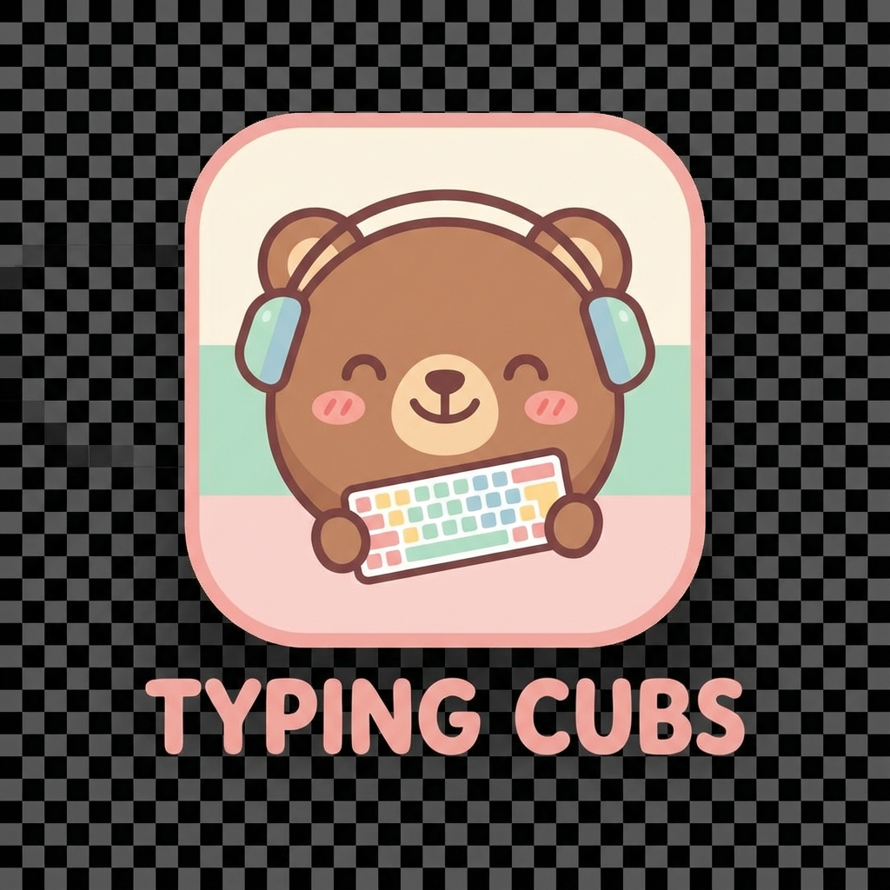

<div align="center">
  
  
  # 🐻 Tappy — 小手哒哒，打字顶呱呱！
  
  **专为 6-12 岁儿童设计的中英双语游戏化打字学习平台**
  
  [立即体验](https://tappy.vercel.app) · [功能介绍](#-核心功能) · [本地运行](#-快速开始) · [技术栈](#️-技术栈)
  
  
  
  
  
  
</div>

---

## ✨ 核心功能

### 🎮 八大游戏模式

| 模式 | 描述 | 适合年龄 |
|:---:|---|:---:|
| 🔤 **字母练习** | 从零开始熟悉键盘位置 | 6-7 岁 |
| 📝 **英文单词** | 常用单词练习，边打边学 | 7-9 岁 |
| 📖 **英文短文** | 趣味英语故事阅读 | 9-12 岁 |
| 🎯 **拼音乐趣** | 汉字配拼音同步学习 | 6-8 岁 |
| 💬 **中文短句** | 日常用语与课文句子 | 7-10 岁 |
| 📚 **小学短文** | 人教版语文美文欣赏 | 8-12 岁 |
| 🏛️ **小学古诗** | 必背古诗词练习 | 6-12 岁 |
| 🏎️ **百米竞速** | 与 AI 对手比赛的趣味模式 | 全年龄 |

### 🏆 游戏化激励系统

- **12 个成就勋章**：从「初次见面」到「Tappy 的好友」，全面追踪成长
- **实时数据统计**：WPM 速度、准确率、连击数、错误分析
- **星级评价系统**：每关最高 3 星，激励持续进步
- **多用户支持**：家庭共享，每个孩子独立追踪进度

### ⌨️ 智能虚拟键盘

- 🌈 **彩色手指分区**：不同颜色区分各手指负责区域
- ✨ **实时高亮提示**：下一个按键自动高亮放大
- 👆 **手指指引动画**：培养正确的指法习惯
- 🔊 **TTS 语音朗读**：高质量中英文语音反馈

### 📚 海量精选内容

- **75+ 首经典古诗词**：从《咏鹅》到《过零丁洋》，覆盖小学 1-6 年级必背
- **20+ 篇人教版课文**：《影子》《黄山奇石》《匆匆》等经典篇目
- **500+ 英语词汇**：分级设计，循序渐进
- **年级筛选**：一键切换 1-6 年级内容难度

---

## 🚀 快速开始

### 在线体验

直接访问 [Tappy](https://tappy.vercel.app)，无需安装，支持添加到桌面离线使用。

### 本地运行

```bash
# 克隆项目
git clone https://github.com/your-username/Tappy.git
cd Tappy

# 安装依赖
npm install

# 启动开发服务器
npm run dev

# 访问 http://localhost:3000
```

### 构建部署

```bash
# 生产构建
npm run build

# 预览构建结果
npm run preview
```

项目已配置 `netlify.toml`，支持一键部署到 Netlify / Vercel。

---

## 🛠️ 技术栈

| 技术 | 版本 | 用途 |
|---|---|---|
| **React** | 19 | UI 框架 |
| **TypeScript** | 5.8 | 类型安全 |
| **Vite** | 6.2 | 构建工具 |
| **TailwindCSS** | 4.0 | 样式框架 |
| **Zustand** | 5.0 | 状态管理 |
| **Dexie** | 4.2 | IndexedDB 封装 |
| **Framer Motion** | 12 | 动画效果 |
| **Recharts** | 3.6 | 数据可视化 |
| **PWA** | - | 离线支持 |

### 项目结构

```
Tappy/
├── components/          # React 组件
│   ├── HomeScreen.tsx       # 首页模式选择
│   ├── TypingArea.tsx       # 打字练习核心组件
│   ├── VirtualKeyboard.tsx  # 虚拟键盘
│   ├── RaceTrack.tsx        # 百米竞速赛道
│   ├── UserProfile.tsx      # 用户档案与统计
│   └── ...
├── data/                # 练习内容数据
│   ├── cn_poems.ts          # 古诗词 (75+)
│   ├── cn_essays.ts         # 小学课文
│   ├── en_words.ts          # 英文单词
│   ├── badges.ts            # 成就勋章定义
│   └── ...
├── store/               # Zustand 状态管理
├── hooks/               # 自定义 Hooks
├── utils/               # 工具函数
├── landing/             # 营销落地页
└── public/              # 静态资源
```

---

## 🎨 设计理念

### 儿童友好的视觉体验
- 🌈 粉蓝渐变背景，柔和舒适
- 🐻 可爱熊头 Logo，亲切有趣
- 🎴 彩色卡片 UI，每个模式专属配色
- ⭐ 活泼动画效果，增添练习趣味

### 循序渐进的教学设计
- 从简单字母到复杂短文，难度阶梯式提升
- 每次敲击即时反馈，正确前进，错误提示
- 关卡式设计，完成后有成就感

### 寓教于乐
- 百米竞速将打字变成刺激的赛跑游戏
- 古诗词模式让打字与文化传承并行
- 勋章系统激励孩子持续练习

---

## 👨‍👩‍👧‍👦 适用人群

- 🎒 **学龄前儿童**：认识键盘，培养打字兴趣
- 📚 **小学生**：系统学习打字，巩固拼音和诗词
- 🌍 **海外华裔儿童**：通过拼音学中文，了解传统文化
- 🏫 **学校/培训机构**：作为打字课程辅助教学工具

---

## 📄 许可证

MIT License © 2024 Tappy

---

<div align="center">
  <p>Made with ❤️ for Kids</p>
  <p><strong>Tappy</strong> — <em>Tap your way to typing mastery!</em> 🐻✨</p>
</div>
